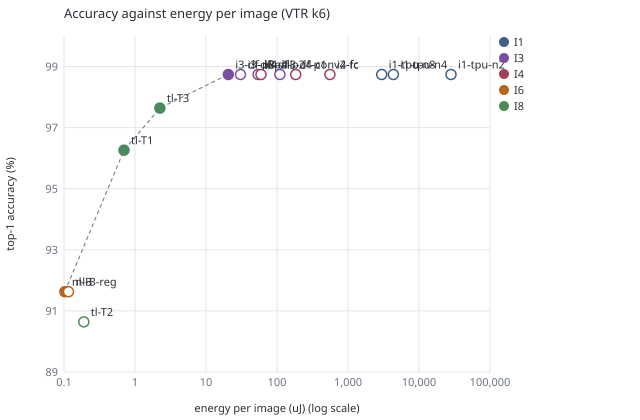
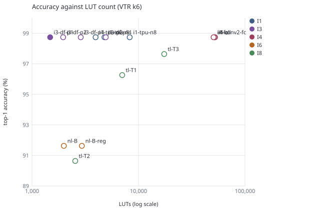
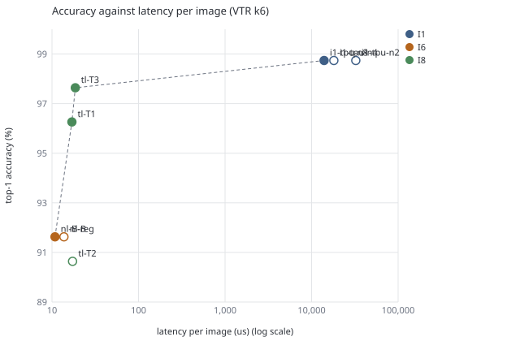
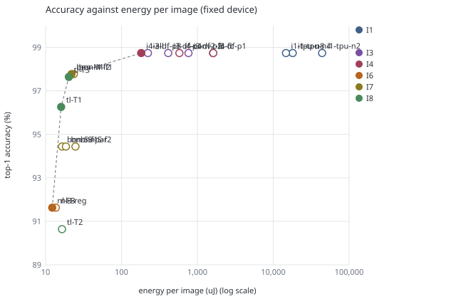
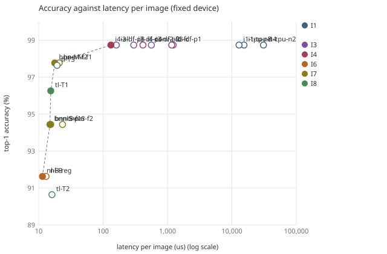

# Results table: AI digit recognition

Generated by `mimir aidigit-table` from the Mimir store (table `aidigit_result`, schema 10); 76 rows from 28 designs. Do not edit by hand; regenerate (see `README.md`, section Results table).

## VTR k6 target

| Impl | Design | Setting | Top-1 % | Images | Grid | LUT | FF | CLB | mult_36 | RAM blk | min W | CLB use % | Fmax MHz | Cycles/img | Latency us | Power mW | W | Energy uJ/img |
|---|---|---|---|---|---|---|---|---|---|---|---|---|---|---|---|---|---|---|
| I1 | i1-tpu-n2 | N=2 (4 MAC units, retiled program of 33,140 instructions, 16-bit program address) | 98.74 | 10,000 | 164x164 | 3,955 | 2,226 | 621 | 13 | 532 | 64 | 3.2 | 49.6 | 1,608,931 | 32,433.5 | 869.1 | 100 | 28,187.933 |
| I1 | i1-tpu-n4 | N=4 (16 MAC units, retiled program of 6,607 instructions) | 98.74 | 10,000 | 86x86 | 4,796 | 2,836 | 527 | 25 | 150 | 60 | 10.0 | 47.2 | 853,184 | 18,063.8 | 241.1 | 100 | 4,355.178 |
| I1 | i1-tpu-n8 | N=8 (64 MAC units, his program of 1,350 instructions) | 98.74 | 10,000 | 80x80 | 8,268 | 5,267 | 899 | 73 | 126 | 88 | 19.9 | 43.7 | 609,339 | 13,939.9 | 214.0 | 100 | 2,983.141 |
| I2 | i2-brisc-i-gcc | BRISC-V mcu core (RV32I, no M), libgcc __mulsi3 | 98.00 | 100 | 32x32 | 4,206 | 1,265 | 402 | 0 | 20 | 82 | 60.9 | 69.9 | 14,662,188 | 209,857.0 | 55.6 | 110† | 11,672.244 |
| I2 | i2-brisc-i-tab | BRISC-V mcu core (RV32I, no M), quarter-square table for 8x8 products | 98.74 | 10,000 | 32x32 | 4,206 | 1,265 | 402 | 0 | 20 | 82 | 60.9 | 69.9 | 8,165,741 | 116,874.6 | 55.6 | 110† | 6,500.566 |
| I2 | i2-pico-fm | picorv32, ENABLE_FAST_MUL (single-cycle multiplier), rv32im, C int8 LeNet-5 | 98.74 | 10,000 | 32x32 | 5,567 | 1,750 | 448 | 0 | 20 | 74 | 67.9 | 62.0 | 5,667,193 | 91,458.9 | 38.3 | 100 | 3,501.960 |
| I2 | i2-pico-i-gcc | picorv32, no multiplier, rv32i, libgcc __mulsi3 | 98.00 | 100 | 32x32 | 2,902 | 1,595 | 275 | 0 | 20 | 68 | 41.7 | 160.6 | 35,714,755 | 222,389.4 | 68.9 | 100 | 15,320.402 |
| I2 | i2-pico-i-tab | picorv32, no multiplier, rv32i, quarter-square table for 8x8 products | 98.74 | 10,000 | 32x32 | 2,902 | 1,595 | 275 | 0 | 20 | 68 | 41.7 | 160.6 | 21,619,520 | 134,620.9 | 68.9 | 100 | 9,274.031 |
| I2 | i2-pico-m | picorv32, ENABLE_MUL (multi-cycle multiplier), rv32im, C int8 LeNet-5 | 98.00 | 100 | n/a | n/a | n/a | n/a | n/a | n/a | n/a | n/a | n/a | 11,904,561 | n/a | n/a | n/a | n/a |
| I3 | i3-df-p1 | P=1 | 98.74 | 10,000 | 38x38 | 1,481 | 1,452 | 182 | 10 | 28 | 38 | 18.7 | 140.3 | 182,666 | 1,302.4 | 84.4 | 100 | 109.945 |
| I3 | i3-df-p2 | P=2 | 98.74 | 10,000 | 38x38 | 1,962 | 1,807 | 226 | 10 | 28 | 42 | 23.3 | 162.9 | 91,759 | 563.1 | 96.2 | 100 | 54.155 |
| I3 | i3-df-p4 | P=4 | 98.74 | 10,000 | 38x38 | 2,869 | 2,547 | 319 | 15 | 28 | 50 | 32.8 | 159.8 | 49,397 | 309.1 | 99.2 | 100 | 30.660 |
| I3 | i3-df-p8 | P=8 lanes per layer (conv1 pads 6 to 8) | 98.74 | 10,000 | 38x38 | 4,926 | 4,035 | 513 | 25 | 28 | 54 | 52.8 | 163.3 | 25,249 | 154.6 | 133.4 | 100 | 20.629 |
| I4 | i4-all | all five layers unrolled across output channels (6, 16, 120, 84, 10 lanes) | 98.74 | 10,000 | 88x88 | 52,259 | 21,377 | 5,448 | 124 | 5 | 180 | 99.0 | 108.0 | 13,161 | 121.9 | 488.8 | 240† | 59.577 |
| I4 | i4-conv2-fc | conv2 (16 lanes) and fc1, fc2, fc3 unrolled; conv1 folded | 98.74 | 10,000 | 87x87 | 51,841 | 21,021 | 5,422 | 123 | 5 | 172 | 99.7 | 110.1 | 43,576 | 395.7 | 462.9 | 230† | 183.172 |
| I4 | i4-fc | fc1, fc2, fc3 unrolled across neurons (120, 84, 10 lanes); conv1, conv2 folded (1 lane) | 98.74 | 10,000 | 90x90 | 50,737 | 19,839 | 5,773 | 115 | 5 | 178 | 99.4 | 108.1 | 124,561 | 1,152.0 | 482.9 | 240† | 556.288 |
| I6 | nl-A | A (neurons 2160, 360, 60, 10; support fan-in 6) | 95.55 | 10,000 | n/a | n/a | n/a | n/a | n/a | n/a | n/a | n/a | n/a | 786 | n/a | n/a | n/a | n/a |
| I6 | nl-B | B (neurons 640, 160, 40, 10; support fan-in 4) | 91.63 | 10,000 | 18x18 | 1,990 | 471 | 188 | 0 | 0 | 74 | 97.9 | 57.2 | 786 | 13.7 | 7.5 | 100 | 0.103 |
| I6 | nl-B-reg | B with a register stage before every layer | 91.63 | 10,000 | 20x20 | 2,938 | 1,643 | 223 | 0 | 0 | 70 | 95.3 | 73.0 | 790 | 10.8 | 10.7 | 100 | 0.116 |
| I6 | nl-C | C (B with 2-bit hidden and support codes) | 96.14 | 10,000 | n/a | n/a | n/a | n/a | n/a | n/a | n/a | n/a | n/a | 786 | n/a | n/a | n/a | n/a |
| I7 | bnn-M-f1 | 784-256-256-256-10, int8 first layer streamed with the pixels; folding PE x SIMD: hidden 16x32, output 10x32 | 97.77 | 10,000 | 78x78 | 33,092 | 6,493 | 4,249 | 0 | 0 | 246 | 98.1 | 51.9 | 1,053 | 20.3 | 317.6 | 320† | 6.439 |
| I7 | bnn-M-f2 | 784-256-256-256-10, int8 first layer streamed with the pixels; folding PE x SIMD: hidden 64x64, output 10x64 | 97.77 | 10,000 | 125x125 | 34,620 | 7,343 | 11,266 | 0 | 0 | 242 | 99.6 | 47.4 | 825 | 17.4 | 759.2 | 320† | 13.213 |
| I7 | bnn-S-f1 | 784-64-64-64-10, input binarised at q >= 54; folding PE x SIMD: first 16x49, hidden 16x16, output 10x16 | 94.44 | 10,000 | 47x47 | 5,560 | 2,613 | 1,522 | 0 | 0 | 42 | 99.5 | 53.9 | 890 | 16.5 | 58.5 | 100 | 0.967 |
| I7 | bnn-S-f2 | 784-64-64-64-10, input binarised at q >= 54; folding PE x SIMD: first 8x16, hidden 8x8, output 2x8 | 94.44 | 10,000 | 35x35 | 7,594 | 2,387 | 777 | 0 | 0 | 162 | 94.2 | 52.6 | 1,350 | 25.7 | 46.2 | 210† | 1.185 |
| I7 | bnn-S-par | 784-64-64-64-10, input binarised at q >= 54; folding PE x SIMD: first 64x98, hidden 64x64 (one cycle), output 10x64 | 94.44 | 10,000 | 113x113 | 8,572 | 2,773 | 9,172 | 0 | 0 | 48 | 99.6 | 51.0 | 801 | 15.7 | 349.1 | 100 | 5.480 |
| I8 | tl-T1 | T1 (w_feature 4, w_tree 3, 30 trees per class, depth 5) | 96.26 | 10,000 | 34x34 | 7,030 | 2,758 | 719 | 0 | 0 | 138 | 93.6 | 46.4 | 788 | 17.0 | 41.2 | 180† | 0.699 |
| I8 | tl-T2 | T2 (w_feature 3, w_tree 2, 15 trees per class, depth 4) | 90.64 | 10,000 | 21x21 | 2,548 | 1,438 | 251 | 0 | 0 | 74 | 94.4 | 45.5 | 786 | 17.3 | 11.0 | 100 | 0.190 |
| I8 | tl-T3 | T3 (w_feature 4, w_tree 4, 60 trees per class, depth 6) | 97.64 | 10,000 | 52x52 | 17,428 | 3,821 | 1,847 | 0 | 0 | 192 | 99.8 | 42.4 | 788 | 18.6 | 120.6 | 250† | 2.243 |

## Cyclone V target (Odin III LPM netlist)

| Impl | Design | Setting | Top-1 % | Cycles/img | lpm_mult | lpm_add_sub | lpm_compare | altsyncram | scfifo | Netlist bytes |
|---|---|---|---|---|---|---|---|---|---|---|
| I1 | i1-tpu-n2 | N=2 (4 MAC units, retiled program of 33,140 instructions, 16-bit program address) | 98.74 | 1,608,931 | 21 | 84 | 327 | 4 | 6 | 26,173,053 |
| I1 | i1-tpu-n4 | N=4 (16 MAC units, retiled program of 6,607 instructions) | 98.74 | 853,184 | 33 | 96 | 333 | 4 | 10 | 8,455,764 |
| I1 | i1-tpu-n8 | N=8 (64 MAC units, his program of 1,350 instructions) | 98.74 | 609,339 | 81 | 144 | 344 | 4 | 18 | 4,944,336 |
| I2 | i2-brisc-i-gcc | BRISC-V mcu core (RV32I, no M), libgcc __mulsi3 | 98.00 | 14,662,188 | 0 | 7 | 72 | 4 | 0 | 1,567,364 |
| I2 | i2-brisc-i-tab | BRISC-V mcu core (RV32I, no M), quarter-square table for 8x8 products | 98.74 | 8,165,741 | 0 | 7 | 72 | 4 | 0 | 1,567,364 |
| I2 | i2-pico-fm | picorv32, ENABLE_FAST_MUL (single-cycle multiplier), rv32im, C int8 LeNet-5 | 98.74 | 5,667,193 | 1 | 8 | 92 | 4 | 0 | 1,600,006 |
| I2 | i2-pico-i-gcc | picorv32, no multiplier, rv32i, libgcc __mulsi3 | 98.00 | 35,714,755 | 0 | 8 | 82 | 4 | 0 | 1,563,209 |
| I2 | i2-pico-i-tab | picorv32, no multiplier, rv32i, quarter-square table for 8x8 products | 98.74 | 21,619,520 | 0 | 8 | 82 | 4 | 0 | 1,563,209 |
| I2 | i2-pico-m | picorv32, ENABLE_MUL (multi-cycle multiplier), rv32im, C int8 LeNet-5 | 98.00 | 11,904,561 | n/a | n/a | n/a | n/a | n/a | n/a |
| I3 | i3-df-p1 | P=1 | 98.74 | 182,666 | 10 | 95 | 54 | 5 | 0 | 2,728,071 |
| I3 | i3-df-p2 | P=2 | 98.74 | 91,759 | 15 | 97 | 64 | 5 | 0 | 2,770,151 |
| I3 | i3-df-p4 | P=4 | 98.74 | 49,397 | 25 | 107 | 72 | 5 | 0 | 2,864,005 |
| I3 | i3-df-p8 | P=8 lanes per layer (conv1 pads 6 to 8) | 98.74 | 25,249 | 45 | 127 | 88 | 5 | 0 | 3,171,463 |
| I4 | i4-all | all five layers unrolled across output channels (6, 16, 120, 84, 10 lanes) | 98.74 | 13,161 | 241 | 323 | 942 | 5 | 0 | 9,755,343 |
| I4 | i4-conv2-fc | conv2 (16 lanes) and fc1, fc2, fc3 unrolled; conv1 folded | 98.74 | 43,576 | 236 | 318 | 983 | 5 | 0 | 9,728,335 |
| I4 | i4-fc | fc1, fc2, fc3 unrolled across neurons (120, 84, 10 lanes); conv1, conv2 folded (1 lane) | 98.74 | 124,561 | 221 | 303 | 1,767 | 5 | 0 | 10,046,047 |
| I6 | nl-A | A (neurons 2160, 360, 60, 10; support fan-in 6) | 95.55 | 786 | 0 | 12 | 100,610 | 0 | 0 | 62,706,493 |
| I6 | nl-B | B (neurons 640, 160, 40, 10; support fan-in 4) | 91.63 | 786 | 0 | 12 | 28,398 | 0 | 0 | 17,601,870 |
| I6 | nl-B-reg | B with a register stage before every layer | 91.63 | 790 | 0 | 12 | 28,399 | 0 | 0 | 17,607,158 |
| I6 | nl-C | C (B with 2-bit hidden and support codes) | 96.14 | 786 | 0 | 12 | 77,452 | 0 | 0 | 47,676,057 |
| I7 | bnn-M-f1 | 784-256-256-256-10, int8 first layer streamed with the pixels; folding PE x SIMD: hidden 16x32, output 10x32 | 97.77 | 1,053 | 0 | 1,620 | 1,389 | 0 | 0 | 3,688,724 |
| I7 | bnn-M-f2 | 784-256-256-256-10, int8 first layer streamed with the pixels; folding PE x SIMD: hidden 64x64, output 10x64 | 97.77 | 825 | 0 | 9,105 | 1,233 | 0 | 0 | 9,679,141 |
| I7 | bnn-S-f1 | 784-64-64-64-10, input binarised at q >= 54; folding PE x SIMD: first 16x49, hidden 16x16, output 10x16 | 94.44 | 890 | 0 | 1,478 | 175 | 0 | 0 | 1,796,298 |
| I7 | bnn-S-f2 | 784-64-64-64-10, input binarised at q >= 54; folding PE x SIMD: first 8x16, hidden 8x8, output 2x8 | 94.44 | 1,350 | 0 | 295 | 626 | 0 | 0 | 1,107,621 |
| I7 | bnn-S-par | 784-64-64-64-10, input binarised at q >= 54; folding PE x SIMD: first 64x98, hidden 64x64 (one cycle), output 10x64 | 94.44 | 801 | 0 | 9,152 | 198 | 0 | 0 | 8,165,465 |
| I8 | tl-T1 | T1 (w_feature 4, w_tree 3, 30 trees per class, depth 5) | 96.26 | 788 | 0 | 301 | 3,098 | 0 | 0 | 6,073,168 |
| I8 | tl-T2 | T2 (w_feature 3, w_tree 2, 15 trees per class, depth 4) | 90.64 | 786 | 0 | 151 | 1,004 | 0 | 0 | 1,820,039 |
| I8 | tl-T3 | T3 (w_feature 4, w_tree 4, 60 trees per class, depth 6) | 97.64 | 788 | 0 | 600 | 4,157 | 0 | 0 | 16,673,791 |

## VTR k6 fixed device (grid 170x170, channel width W = 320)

| Impl | Design | Top-1 % | Grid | W | CLB | CLB use % | Fmax MHz | Wirelength | Latency us | Power mW | Static mW | Energy uJ/img |
|---|---|---|---|---|---|---|---|---|---|---|---|---|
| I1 | i1-tpu-n2 | 98.74 | 170x170 | 320† | 395 | 1.9 | 52.0 | 192,191 | 30,931.5 | 1,425.0 | 910.1 | 44,077.441 |
| I1 | i1-tpu-n4 | 98.74 | 170x170 | 320† | 471 | 2.2 | 55.4 | 112,895 | 15,395.1 | 1,171.0 | 910.0 | 18,027.672 |
| I1 | i1-tpu-n8 | 98.74 | 170x170 | 320† | 805 | 3.8 | 47.2 | 181,987 | 12,907.3 | 1,141.0 | 914.1 | 14,727.186 |
| I3 | i3-df-p1 | 98.74 | 170x170 | 320† | 180 | 0.9 | 149.1 | 22,427 | 1,224.9 | 1,313.0 | 905.3 | 1,608.238 |
| I3 | i3-df-p2 | 98.74 | 170x170 | 320† | 227 | 1.1 | 163.4 | 28,125 | 561.5 | 1,359.0 | 905.1 | 763.068 |
| I3 | i3-df-p4 | 98.74 | 170x170 | 320† | 302 | 1.4 | 165.0 | 41,358 | 299.4 | 1,380.0 | 907.1 | 413.125 |
| I3 | i3-df-p8 | 98.74 | 170x170 | 320† | 486 | 2.3 | 157.1 | 65,671 | 160.7 | 1,388.0 | 910.5 | 223.061 |
| I4 | i4-all | 98.74 | 170x170 | 320† | 5,382 | 25.4 | 99.5 | 1,232,088 | 132.2 | 1,377.0 | 990.3 | 182.088 |
| I4 | i4-conv2-fc | 98.74 | 170x170 | 320† | 5,316 | 25.1 | 104.8 | 1,231,325 | 415.7 | 1,396.0 | 991.4 | 580.355 |
| I4 | i4-fc | 98.74 | 170x170 | 320† | 5,241 | 24.8 | 107.2 | 1,213,607 | 1,161.7 | 1,393.0 | 988.1 | 1,618.223 |
| I6 | nl-B | 91.63 | 170x170 | 320† | 193 | 0.9 | 60.5 | 33,969 | 13.0 | 1,048.0 | 905.5 | 13.619 |
| I6 | nl-B-reg | 91.63 | 170x170 | 320† | 228 | 1.1 | 69.1 | 35,451 | 11.4 | 1,071.0 | 905.6 | 12.236 |
| I7 | bnn-M-f1 | 97.77 | 170x170 | 320† | 4,159 | 19.6 | 50.5 | 1,144,855 | 20.8 | 1,131.0 | 973.3 | 23.563 |
| I7 | bnn-M-f2 | 97.77 | 170x170 | 320† | 11,035 | 52.1 | 46.6 | 1,259,369 | 17.7 | 1,236.0 | 984.2 | 21.905 |
| I7 | bnn-S-f1 | 94.44 | 170x170 | 320† | 1,541 | 7.3 | 57.9 | 85,953 | 15.4 | 1,072.0 | 912.5 | 16.466 |
| I7 | bnn-S-f2 | 94.44 | 170x170 | 320† | 809 | 3.8 | 57.6 | 160,187 | 23.4 | 1,056.0 | 915.7 | 24.737 |
| I7 | bnn-S-par | 94.44 | 170x170 | 320† | 9,162 | 43.3 | 53.6 | 507,975 | 14.9 | 1,239.0 | 937.4 | 18.512 |
| I8 | tl-T1 | 96.26 | 170x170 | 320† | 709 | 3.3 | 51.2 | 168,745 | 15.4 | 1,041.0 | 914.3 | 16.026 |
| I8 | tl-T2 | 90.64 | 170x170 | 320† | 253 | 1.2 | 49.0 | 38,353 | 16.0 | 1,024.0 | 906.2 | 16.430 |
| I8 | tl-T3 | 97.64 | 170x170 | 320† | 1,821 | 8.6 | 40.9 | 615,363 | 19.3 | 1,049.0 | 941.6 | 20.217 |

## Odin III v1.6.1 simulation (`sim_tb` on the RTL)

| Impl | Design | 2-image tier | Cycles/s | Wall s | 100-image quick tier |
|---|---|---|---|---|---|
| I1 | i1-tpu-n2 | error (cause in TABLE.csv) | n/a | n/a | n/a |
| I1 | i1-tpu-n4 | error (cause in TABLE.csv) | n/a | n/a | n/a |
| I1 | i1-tpu-n8 | error (cause in TABLE.csv) | n/a | n/a | n/a |
| I2 | i2-brisc-i-gcc | not run | n/a | n/a | n/a |
| I2 | i2-brisc-i-tab | not run | n/a | n/a | n/a |
| I2 | i2-pico-fm | not run | n/a | n/a | n/a |
| I2 | i2-pico-i-gcc | not run | n/a | n/a | n/a |
| I2 | i2-pico-i-tab | not run | n/a | n/a | n/a |
| I2 | i2-pico-m | not run | n/a | n/a | n/a |
| I3 | i3-df-p1 | pass: class 2/2, score 2/2 | 978 | 373.2 | running |
| I3 | i3-df-p2 | pass: class 2/2, score 2/2 | 822 | 223.0 | running |
| I3 | i3-df-p4 | pass: class 2/2, score 2/2 | 608 | 162.3 | running |
| I3 | i3-df-p8 | pass: class 2/2, score 2/2 | 323 | 156.0 | running |
| I4 | i4-all | pass: class 2/2, score 2/2 | 21 | 1,216.9 | running |
| I4 | i4-conv2-fc | pass: class 2/2, score 2/2 | 27 | 3,169.4 | running |
| I4 | i4-fc | pass: class 2/2, score 2/2 | 24 | 10,117.7 | running |
| I6 | nl-A | pass: class 2/2, score 2/2 | 7 | 217.7 | running |
| I6 | nl-B | pass: class 2/2, score 2/2 | 31 | 49.8 | running |
| I6 | nl-B-reg | pass: class 2/2, score 2/2 | 30 | 51.5 | running |
| I6 | nl-C | pass: class 2/2, score 2/2 | 10 | 144.4 | running |
| I7 | bnn-M-f1 | pass: class 2/2, score 2/2 | 21 | 99.8 | running |
| I7 | bnn-M-f2 | pass: class 2/2, score 2/2 | 16 | 102.6 | running |
| I7 | bnn-S-f1 | pass: class 2/2, score 2/2 | 117 | 15.2 | running |
| I7 | bnn-S-f2 | pass: class 2/2, score 2/2 | 134 | 20.1 | running |
| I7 | bnn-S-par | pass: class 2/2, score 2/2 | 46 | 34.6 | running |
| I8 | tl-T1 | pass: class 2/2, score 2/2 | 91 | 17.3 | running |
| I8 | tl-T2 | pass: class 2/2, score 2/2 | 628 | 2.5 | running |
| I8 | tl-T3 | pass: class 2/2, score 2/2 | 40 | 39.0 | running |

## Notes

1. Accuracy is top-1 against the MNIST test labels over the images shown (10,000 = full test set). I1 is the reference LeNet-5, bit-exact: class and all ten scores equal the numpy golden (docs/GOLDEN.md). I6 and I8 are other models: they match the Python model of the design, not the golden.
2. Area, speed and power come from the quick-tier legs (100 images); they do not depend on the tier. Latency = cycles per image x critical path; the designs are not pipelined across images, so images/s = 1 / latency. Energy per image = total power x latency.
3. Power is ACE2 vectorless activity (-s 1) with the VPR power model (PTM 45 nm): a ranking estimate, not a measurement.
4. † Routed and powered at channel width W other than 100: not same-W comparable with the other rows.
5. Cyclone V (5CSEMA5F31C6) fit, timing and power are parked (Quartus not run; Peter 2026-11-10); that target shows Odin III LPM instance counts only. A type with no instance counts as 0.
6. Grid = VPR auto-sized square grid for k6_frac_N10 (10 BLEs per CLB); the largest resource column (RAM, DSP or CLB) sets the size. min W = minimum routable channel width. CLB use = CLBs used / CLB tiles of the grid (IO ring, RAM and mult_36 columns excluded).
7. Fixed device: every design placed and routed from its existing flow BLIF (no re-synthesis) on one grid at one channel width (the numbers are in the heading of that table), power by the same ACE2 + VPR model. The whole device leaks whatever the design uses, so static power and energy per image are those of the full grid; a small design pays for the empty tiles. CLB use % there is CLBs used / CLB tiles of the fixed grid.
8. n/a = not measured. The reason for every n/a is in the store (table `aidigit_null`) and in the last column of TABLE.csv; e.g. nl-A and nl-C: the Odin III `abc` pass exceeds its 4 GiB budget.

## Pareto plots (VTR k6, front marked with filled dots)

No VTR point (no area, speed or power): i2-pico-m, nl-A, nl-C.
